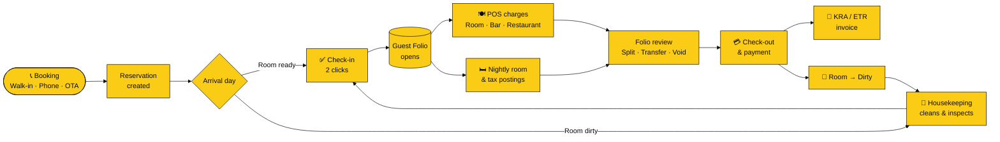
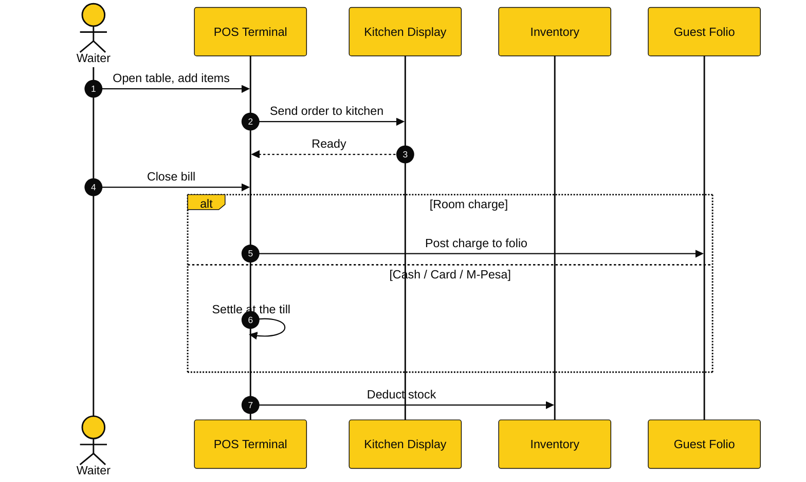
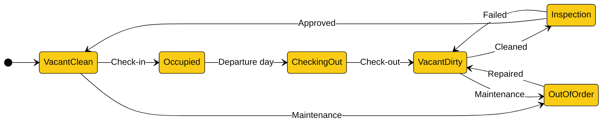
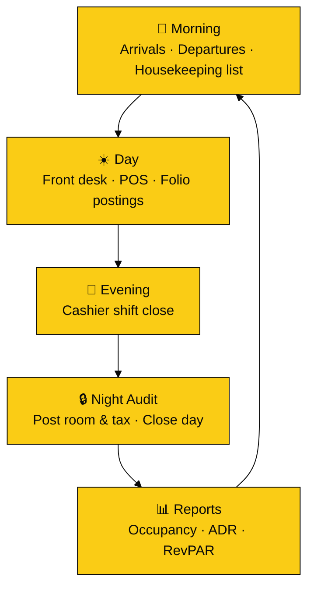
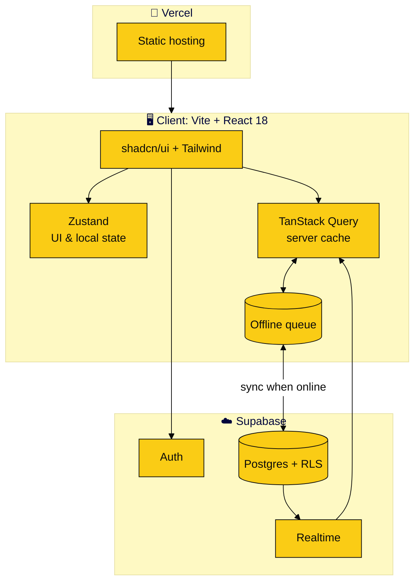

<div align="center">


<br/>

**Replace Opera Cloud and the paper ledger with one fast, professional platform.**<br/>
Front Desk · Reservations · Housekeeping · Billing · Restaurant POS — built for Africa, works without internet.

<br/>

[](https://olitechpmspos.vercel.app)


[**Features**](#-features) · [**Workflows**](#-workflows) · [**Architecture**](#-architecture) · [**Quick Start**](#-quick-start) · [**Brand**](#-brand) · [**Roles**](#-roles--permissions) · [**Roadmap**](#-roadmap)

</div>

---

## ✨ Why Olitech?

| | |
|---|---|
| 🌍 **Built for African operations** | Power cuts and patchy connectivity are the norm, not the exception. Olitech keeps working offline and syncs when the network returns. |
| 🧾 **Kenya-ready compliance** | KRA / ETR compliant invoicing out of the box. |
| 🔗 **One folio, every department** | Restaurant, bar and room charges land on the same guest folio. No re-keying, no end-of-day reconciliation headaches. |
| ⚡ **Two-click front desk** | Check-in and check-out in two clicks. Drag and drop reservations on the rack. |
| 🏢 **Multi-property ready** | Multiple properties and workspaces under one account. |

---

## 📸 Screenshots

<table>
  <tr>
    <td align="center" width="50%"><b>Dashboard</b><br/><sub>Occupancy, arrivals, departures and revenue at a glance</sub></td>
    <td align="center" width="50%"><b>Room Rack</b><br/><sub>Drag-and-drop calendar with colour-coded status</sub></td>
  </tr>
  <tr>
    <td></td>
    <td></td>
  </tr>
  <tr>
    <td align="center"><b>Folio / Billing</b><br/><sub>Split, transfer, void and city ledger</sub></td>
    <td align="center"><b>Restaurant POS</b><br/><sub>Tables, orders, KDS and room charge</sub></td>
  </tr>
  <tr>
    <td></td>
    <td></td>
  </tr>
</table>

> Regenerate all screenshots with `npm run screenshots` (see [Capturing screenshots](#-capturing-screenshots)).

<details>
<summary><b>🎨 Room status colour guide</b></summary>
<br/>

| Status | Colour | Meaning |
|---|---|---|
| 🟩 Vacant Clean | Green | Ready to sell |
| 🟧 Vacant Dirty | Amber | Awaiting housekeeping |
| 🟦 Occupied | Blue | Guest in house |
| 🟪 Checking Out Today | Indigo | Departure due |
| ⬜ Out of Order | Grey, diagonal stripe | Not sellable |

</details>

---

## 🧩 Features

### 🏨 PMS: Property Management

| Module | What you get |
|---|---|
| **Room Rack** | Visual calendar with drag-and-drop reservations and room moves |
| **Reservations** | Create, amend and cancel. Check-in and check-out in 2 clicks |
| **Rates & Inventory** | Room types, rate plans, taxes and fees |
| **Guests** | Guest profiles with full stay history |
| **Folio Management** | Split, transfer, void, and post to City Ledger |
| **Housekeeping** | Dirty, Clean, Out of Order and Inspection workflow |
| **Night Audit** | Day closure and end-of-day rollover |
| **Reports** | Occupancy, ADR, RevPAR and Cashier reports |

### 🍽️ POS: Point of Sale

| Module | What you get |
|---|---|
| **Outlets** | Restaurant, Bar and Coffee Shop POS |
| **Floor & Tables** | Table and floor management |
| **KDS** | Kitchen Display System, so orders reach the kitchen instantly |
| **Room Charge** | Post a bill directly to a guest folio |
| **Inventory** | Automatic stock deduction on sale |

### 🛡️ Platform

- **Offline-first**: keeps working without internet
- **Multi-property and multi-workspace**
- **Role-based access**: Admin, Front Desk, Housekeeping, POS, Accountant
- **KRA / ETR compliant invoicing** (Kenya)

---

## 🔄 Workflows

### 1. Guest journey, from booking to settlement



### 2. Restaurant order to room charge



### 3. Room status lifecycle



### 4. Daily operations cycle



---

## 🏗️ Architecture



| Layer | Technology |
|---|---|
| **Frontend** | Vite · React 18 · Tailwind CSS · shadcn/ui |
| **State** | Zustand + TanStack Query *(migrating from `PmsStore.jsx` / `AppStore.jsx`)* |
| **Backend** | Supabase: Postgres, Auth, Row Level Security, Realtime |
| **Auth** | Supabase Auth *(migrating from the `src/services/authService.js` localStorage layer)* |
| **Deployment** | Vercel |

> **🔐 Multi-tenant by design.** Every table is scoped to a business and branch, and access is enforced with Postgres Row Level Security, so one property can never read another's data.

---

## 🎨 Brand

| | Hex | Use |
|---|---|---|
| ⬛ **Black** | `#0A0A0A` | Sidebar, headers, primary text |
| 🟨 **Yellow** | `#FACC15` | Primary actions, highlights, active states |
| ⬜ **White** | `#FFFFFF` | Surfaces and cards |

Room status colours (green, amber, blue, indigo, grey) stay semantic and are not part of the brand palette.

---

## 🚀 Quick Start

**Prerequisites:** Node.js 18+ and a free [Supabase](https://supabase.com) project.

```bash
# 1. Clone
git clone https://github.com/olitechs/olitechpmspos.git
cd olitechpmspos

# 2. Install
npm install

# 3. Configure environment
cp .env.example .env.local
# then add your keys:
#   VITE_SUPABASE_URL=...
#   VITE_SUPABASE_ANON_KEY=...

# 4. Run
npm run dev

# 5. Build for production
npm run build
```

> **First login:** the first account you create becomes the **Admin**.

### Scripts

| Command | Description |
|---|---|
| `npm run dev` | Start the dev server |
| `npm run build` | Production build |
| `npm run preview` | Preview the production build locally |

---

## 📷 Capturing screenshots

Screenshots are produced from the running app with [Playwright](https://playwright.dev), so they always match the current UI.

```bash
npm i -D playwright
npx playwright install chromium
npm run dev            # in one terminal
npm run screenshots    # in another
```

Add this to `package.json`:

```json
"scripts": { "screenshots": "node scripts/capture-screenshots.mjs" }
```

Set `OLITECH_EMAIL` and `OLITECH_PASSWORD` to log in. Edit the `SHOTS` list in `scripts/capture-screenshots.mjs` if your routes differ.

---

## 👥 Roles & Permissions

| Role | Front Desk | Housekeeping | POS | Billing / Folio | Reports | Settings |
|---|:---:|:---:|:---:|:---:|:---:|:---:|
| **Admin** | ✅ | ✅ | ✅ | ✅ | ✅ | ✅ |
| **Front Desk** | ✅ | 👁️ | 👁️ | ✅ | 👁️ | ❌ |
| **Housekeeping** | ❌ | ✅ | ❌ | ❌ | ❌ | ❌ |
| **POS** | ❌ | ❌ | ✅ | 🔸 Room charge only | ❌ | ❌ |
| **Accountant** | ❌ | ❌ | 👁️ | ✅ | ✅ | ❌ |

✅ Full access · 👁️ View only · 🔸 Limited · ❌ No access

> The matrix above is the intended default. Adjust it to match your implementation.

---

## 🗂️ Project Structure

```text
olitechpmspos/
├── src/
│   ├── components/      # shadcn/ui and shared components
│   ├── pages/           # Dashboard, Rack, Reservations, Folio, POS ...
│   ├── services/        # Supabase and auth service layer
│   ├── store/           # Zustand stores
│   └── lib/             # Helpers and utilities
├── docs/
│   ├── assets/          # Banner and diagrams
│   └── screenshots/     # README screenshots (generated)
├── scripts/
│   └── capture-screenshots.mjs
├── .env.example
└── package.json
```

> Update folder names to match the actual repo layout.

---

## 🧭 Roadmap

- [x] Room Rack, Reservations, Folio, Housekeeping, Night Audit
- [x] Restaurant / Bar POS with KDS and room charge
- [x] KRA / ETR compliant invoicing
- [ ] Complete migration from localStorage auth to Supabase Auth
- [ ] Complete migration from `PmsStore` / `AppStore` to Zustand + TanStack Query
- [ ] Design-system refresh: unified palette, calmer dashboard
- [ ] Payments and reporting expansion
- [ ] Roles and licensing
- [ ] Hardware support: receipt and kitchen printers, cash drawers
- [ ] Channel manager and OTA integrations

---

## 🤝 Contributing

1. Fork the repo and create a branch: `git checkout -b feature/my-feature`
2. Commit your changes: `git commit -m "feat: add my feature"`
3. Push and open a Pull Request

Please keep PRs focused, and describe the problem and the fix.

---

## 📄 License

Released under the [MIT License](LICENSE).

---

<div align="center">

**Built with ❤️ for the hospitality industry in Africa.**

[Live Demo](https://olitechpmspos.vercel.app) · [Report a Bug](https://github.com/olitechs/olitechpmspos/issues) · [Request a Feature](https://github.com/olitechs/olitechpmspos/issues)

</div>
