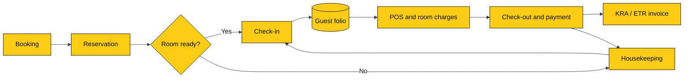
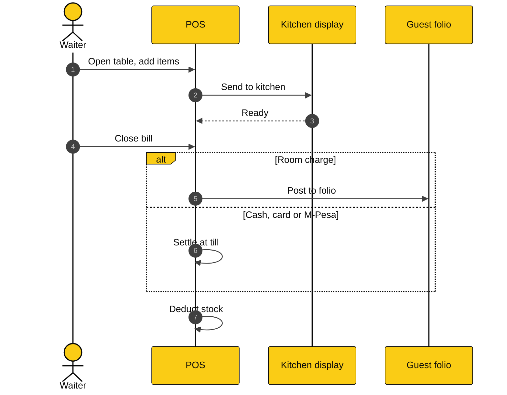
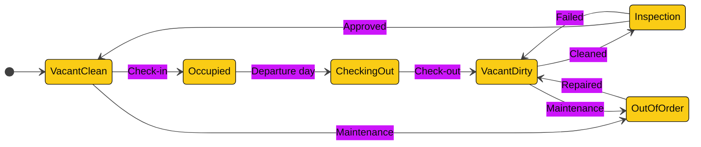
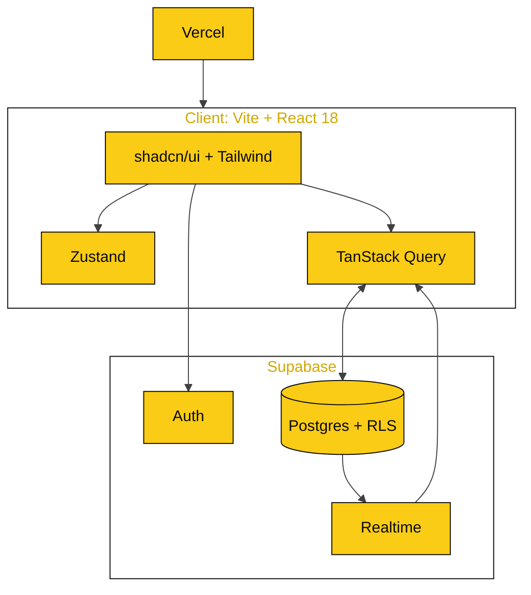

<div align="center">


<br/>

**Front desk, reservations, housekeeping, billing and restaurant POS in one platform.**
Built to replace Opera Cloud and manual books for hotels, lodges and serviced apartments in Africa.

<br/>

[](https://olitechpmspos.vercel.app)


[Features](#features) · [Screenshots](#screenshots) · [Workflows](#workflows) · [Architecture](#architecture) · [Quick start](#quick-start) · [Roadmap](#roadmap)

</div>

<br/>

## Overview

Olitech PMS is a single system for the whole property. A guest books, checks in, eats at the restaurant, and settles one folio at check-out, with no re-keying between departments.

| | |
|---|---|
| **Offline-first** | Keeps working through power cuts and weak connections. |
| **One folio** | Room, restaurant and bar charges post to the same guest bill. |
| **Fast front desk** | Check-in and check-out in two clicks. Drag and drop on the rack. |
| **Kenya-ready** | KRA / ETR compliant invoicing. |
| **Multi-property** | Several properties and workspaces under one account. |

<br/>

## Screenshots

<table>
  <tr>
    <td width="50%"><br/><b>Dashboard</b><br/><sub>Arrivals, departures, occupancy and revenue.</sub></td>
    <td width="50%"><br/><b>Room rack</b><br/><sub>Drag-and-drop calendar with status colours.</sub></td>
  </tr>
  <tr>
    <td width="50%"><br/><b>Folio and billing</b><br/><sub>Split, transfer, void and city ledger.</sub></td>
    <td width="50%"><br/><b>Restaurant POS</b><br/><sub>Tables, orders, kitchen display, room charge.</sub></td>
  </tr>
</table>

<br/>

## Features

### Property management

| Module | Capabilities |
|---|---|
| Room rack | Visual calendar, drag-and-drop reservations and room moves |
| Reservations | Create, amend, cancel. Two-click check-in and check-out |
| Rates | Room types, rate plans, taxes and fees |
| Guests | Profiles with full stay history |
| Folio | Split, transfer, void, City Ledger |
| Housekeeping | Dirty, Clean, Out of Order, Inspection |
| Night audit | Day closure and rollover |
| Reports | Occupancy, ADR, RevPAR, Cashier |

### Point of sale

| Module | Capabilities |
|---|---|
| Outlets | Restaurant, Bar, Coffee Shop |
| Floor | Tables and floor plan |
| Kitchen | Kitchen Display System (KDS) |
| Room charge | Post a bill straight to a guest folio |
| Inventory | Stock deducted on sale |

### Platform

- Offline-first operation
- Multi-property and multi-workspace
- Role-based access: Admin, Front Desk, Housekeeping, POS, Accountant
- KRA / ETR compliant invoicing

<br/>

## Workflows

### Guest journey



### Restaurant order to room charge



### Room status



| Status | Colour |
|---|---|
| Vacant clean | Green |
| Vacant dirty | Amber |
| Occupied | Blue |
| Checking out today | Indigo |
| Out of order | Grey, diagonal stripe |

<br/>

## Architecture



| Layer | Technology |
|---|---|
| Frontend | Vite, React 18, Tailwind CSS, shadcn/ui |
| State | Zustand, TanStack Query (migrating from `PmsStore.jsx` and `AppStore.jsx`) |
| Backend | Supabase: Postgres, Auth, Row Level Security, Realtime |
| Auth | Supabase Auth (migrating from the localStorage layer in `src/services/authService.js`) |
| Hosting | Vercel |

<br/>

## Quick start

Requires Node.js 18+ and a [Supabase](https://supabase.com) project.

```bash
git clone https://github.com/olitechs/olitechpmspos.git
cd olitechpmspos
npm install

cp .env.example .env.local
# set VITE_SUPABASE_URL and VITE_SUPABASE_ANON_KEY

npm run dev        # development
npm run build      # production build
```

The first account you create becomes the **Admin**.

<br/>

## Roles

| Role | Front desk | Housekeeping | POS | Folio | Reports | Settings |
|---|:---:|:---:|:---:|:---:|:---:|:---:|
| Admin | Full | Full | Full | Full | Full | Full |
| Front Desk | Full | View | View | Full | View | None |
| Housekeeping | None | Full | None | None | None | None |
| POS | None | None | Full | Room charge | None | None |
| Accountant | None | None | View | Full | Full | None |

Treat this as the intended default and adjust it to match the implementation.

<br/>

## Screenshots, regenerated

Screenshots come from the running app with [Playwright](https://playwright.dev).

```bash
npm i -D playwright && npx playwright install chromium
npm run dev
OLITECH_EMAIL=you@example.com OLITECH_PASSWORD=secret node scripts/capture-screenshots.mjs
```

<br/>

## Brand

| Colour | Hex | Use |
|---|---|---|
| Black | `#0A0A0A` | Sidebar, headers, text |
| Yellow | `#FACC15` | Primary actions and highlights. Use on black, never as text on white. |
| White | `#FFFFFF` | Surfaces and cards |

<br/>

## Roadmap

- [x] Room rack, reservations, folio, housekeeping, night audit
- [x] Restaurant and bar POS with KDS and room charge
- [x] KRA / ETR invoicing
- [ ] Move auth from localStorage to Supabase Auth
- [ ] Move `PmsStore` and `AppStore` to Zustand and TanStack Query
- [ ] Unified design system and calmer dashboard
- [ ] Payments and reporting expansion
- [ ] Hardware: receipt and kitchen printers, cash drawers
- [ ] Channel manager and OTA integrations

<br/>

## Engineering audit notes

- [Phase 0 repository audit and stock-control roadmap](docs/PHASED_REPO_AUDIT_AND_STOCK_CONTROL_ROADMAP.md)
- [Phase 2 inventory security and data-integrity audit](docs/PHASE2_INVENTORY_SECURITY_AUDIT.md) — read-only findings; database changes remain gated.

## Contributing

Fork, branch (`feature/my-feature`), commit, and open a pull request. Keep changes focused and describe the problem and the fix.

## License

[MIT](LICENSE)

<div align="center">
<br/>

[Live demo](https://olitechpmspos.vercel.app) · [Report a bug](https://github.com/olitechs/olitechpmspos/issues) · [Request a feature](https://github.com/olitechs/olitechpmspos/issues)

</div>
