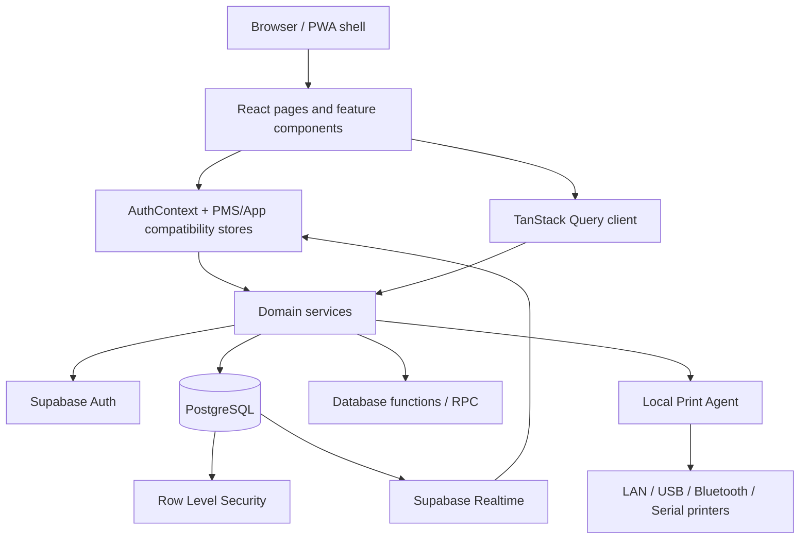

<div align="center">

# OliTechs

<br />

**Hospitality operations, connected.**

A multi-workspace Property Management System and Point of Sale for hotels, resorts, lodges, restaurants and serviced apartments.

[Live application](https://olitechpmspos.vercel.app) · **React 18** · **Vite 6** · **Supabase/Postgres** · **MIT**

[Overview](#1-product-overview) · [Workflows](#3-end-to-end-workflows) · [Modules](#4-module-by-module-guide) · [Architecture](#5-technical-architecture) · [Setup](#9-local-development-setup)

</div>

---

## 1. Product overview

OliTechs brings the daily work of a hospitality business into one application. A property team can manage guest stays, room availability, restaurant orders, stock, billing, staff access and operational reporting through connected workspaces.

The intended guest lifecycle is:

**Enquiry / booking → reservation → arrival → stay → restaurant and service charges → folio settlement → departure → reporting.**

The application is a Vite + React single-page application backed by Supabase services and PostgreSQL. The current implementation is hybrid: several operational domains already use Supabase, while React context stores and some demo/static data remain in use. Read the implementation notes below before assuming every screen is fully cloud-backed or offline-capable.

### Product principles

- One property-aware workspace for day-to-day hotel operations.
- Shared guest and billing context between front office and POS where supported.
- Role, property membership, subscription and server-side database policies govern access.
- Operational actions that require consistency belong in database functions/RPCs, not only in the browser.
- Device printing is handled through supported browser APIs or the local Print Agent.
- Offline-first capability is a product direction; it is not a claim that every workflow currently works without internet.

## 2. Application map

### Public and account routes

| Route | Purpose |
|---|---|
| `/`, `/home` | Public landing page |
| `/signin`, `/signup` | Public sign-in and registration entry points |
| `/login`, `/register` | Account login and registration pages |
| `/forgot-password`, `/reset-password` | Password recovery |
| `/admin/login` | Separate platform administrator login |

### Property workspaces

| Route | Workspace | Main responsibility |
|---|---|---|
| `/backoffice` | Back Office | Business overview, products, categories, inventory, employees, reports and settings |
| `/frontoffice` | Front Office | Room planner, reservations, guest folios, housekeeping and night audit |
| `/pos` | Point of Sale | Restaurant/bar floor, tables, orders, bills and payments |
| `/stores` | Stores | Stock, store operations, devices, printers and kitchen display |
| `/admin` | Platform Admin | Platform-level property, membership, subscription and administration |

Legacy convenience routes redirect into the current workspace structure: `/dashboard` → `/backoffice`, `/pms` → `/frontoffice`, `/store` → `/stores`, and `/rooms` → `/frontoffice/rooms`.

## 3. End-to-end workflows

### 3.1 New business registration and property onboarding

1. A business owner opens the public site and selects registration.
2. The registration form collects the account identity and business/property name.
3. Supabase Auth creates the user identity. The registration flow invokes the server-side property application process.
4. The user profile and property membership/application are loaded by the authentication service.
5. A property awaiting approval is directed to the pending-approval experience.
6. A platform owner reviews the application in Platform Admin and manages the property status, package and owner assignment.
7. Once the property is active and has an eligible package, the owner can enter the permitted property workspaces.

**Implementation:** `AuthContext.jsx`, `authService.js`, `AdminRoute.jsx`, platform services and Supabase RPC/RLS policies.

### 3.2 Login, session restoration and access checks

1. The user signs in through Supabase Auth.
2. The app loads the user profile and property membership.
3. The app resolves the property, staff record, role and subscription information.
4. The route guard checks authentication and whether the role/package permits the requested workspace.
5. The user is routed to an allowed workspace or the pending-approval/login flow.
6. Supabase auth-state events keep the React session aligned with token refresh and sign-out events. Property and subscription changes can trigger a refreshed user context.

Do not treat browser storage, a hidden menu item or a client-side role flag as an authorization boundary. PostgreSQL RLS and server-side checks must enforce access.

### 3.3 Front office: reservations and room planning

1. Reception opens the Front Office workspace.
2. The room planner displays room inventory and reservation context.
3. Staff create a reservation with guest details, room, arrival/departure dates, occupancy, rate, channel and other booking information.
4. Staff amend or cancel the reservation when permitted.
5. Room and reservation data are loaded and changed through the PMS service layer and Supabase.
6. The room planner and reservation screens refresh their state after successful operations.
7. On arrival, reception confirms the reservation and proceeds with check-in when the room and guest are ready.

The PMS context currently adapts backend room and reservation records into the shapes expected by existing screens. This compatibility layer is intentional while the UI is migrated incrementally.

### 3.4 Arrival, in-house stay and guest folio

1. Reception finds the arriving reservation or guest.
2. Staff verify the guest/stay details and assign or confirm the room.
3. The reservation moves through its supported booking/check-in status.
4. The guest remains associated with the room and stay dates while in-house.
5. Accommodation, service and eligible POS charges are recorded against the relevant guest/folio workflow.
6. Reception reviews the folio, checks payments and resolves outstanding balances before departure.

Folio operations should preserve an auditable transaction history. Do not silently overwrite or delete financial history to correct a posted charge; use the approved adjustment/void workflow.

### 3.5 Housekeeping and room readiness

1. Housekeeping opens the housekeeping workspace/board.
2. Staff review rooms requiring cleaning, inspection or maintenance attention.
3. A room is updated as work progresses.
4. A supervisor or authorized staff member inspects the room where the workflow requires it.
5. Once approved, the room becomes available for the next assignment.
6. Out-of-order or maintenance rooms must not be treated as sellable inventory.

Room status and reservation status are related but distinct: a room can be vacant and dirty, occupied, under inspection or unavailable for maintenance.

### 3.6 Restaurant and bar POS

1. A waiter/cashier opens the POS workspace and selects an outlet, service zone and table.
2. The user opens a table session and adds menu items, quantities and modifiers.
3. The order is routed to the relevant production centre/Kitchen Display System.
4. Kitchen/bar staff prepare the order and update its progress.
5. The waiter adds further items or requests the bill.
6. The bill is settled using an enabled payment method, or posted to a guest folio where that option is available and authorized.
7. The table session is closed after settlement/transfer.
8. Stock deduction and sales/receipt records are processed through the configured POS and inventory operations.

Active table sessions are loaded from Supabase and can receive Realtime updates. The application store coordinates UI state and calls the POS service; it is not itself the financial system of record.

### 3.7 Kitchen Display System

1. POS sends ordered items to their production centre.
2. The KDS displays active kitchen/bar tickets.
3. Staff update ticket progress as items are accepted, prepared and completed.
4. POS and KDS state is refreshed through the available persistence and Realtime mechanisms.
5. Completed or cancelled tickets leave the active queue according to the implemented workflow.

### 3.8 Inventory, purchasing and stock control

1. An authorized user manages product catalogue entries, categories, units, suppliers and store locations.
2. Purchase orders are created against suppliers and include the expected products/quantities.
3. On delivery, authorized staff receive the order and confirm received quantities.
4. Stock adjustments, transfers, counts and production/recipe operations record stock movements through the inventory service and database functions.
5. POS sales consume stock according to the configured menu/inventory integration.
6. Managers review stock levels, valuation and movement history.

Inventory cost visibility is role-sensitive in the service layer. Database policies and RPC authorization remain essential; frontend hiding is not sufficient security.

### 3.9 Cashier, receipts and financial close

1. Cashier staff review open bills and payment activity.
2. They record permitted settlements and handle receipt operations.
3. Voids, item removals and adjustments follow the applicable approval controls.
4. Night Audit reviews the operational day and runs the supported close/rollover process.
5. Daily reporting summarizes operational and financial activity from persisted records.

**Important:** payment-provider confirmation, statutory e-invoicing and live KRA/ETR connectivity must be verified against the actual configured integration before being represented as active in a production deployment.

### 3.10 Printing and hardware

OliTechs supports a browser-based printing layer with multiple connection paths:

- **Network thermal printers:** browser sends a request to the local Print Agent; the agent communicates with the printer over the local network.
- **USB:** WebUSB where supported and permission is granted.
- **Bluetooth:** Web Bluetooth where supported and permission is granted.
- **Serial:** Web Serial where supported.
- **System printer:** browser/OS print dialog.

For network printers, install and run the Print Agent on the workstation that can reach the printer. The default local agent address is `http://127.0.0.1:8631`. A saved printer configuration is not proof that a physical printer is connected; the service reports connection only after a genuine test.

See [Print Agent setup](docs/PRINT_AGENT_SETUP.md).

### 3.11 Platform administration

Platform administrators use the separate `/admin` route group to manage the SaaS platform rather than hotel operations. Available administration areas include property applications and records, property status/package, owner assignment, members/roles, subscription settings, audit log and platform settings.

Platform routes are guarded separately from normal property workspaces.

## 4. Module-by-module guide

| Area | Main modules and responsibilities |
|---|---|
| Dashboard | Operational overview and navigation into workspaces |
| Reservations | Create, view and maintain guest bookings |
| Room Planner / Rooms | Room inventory, occupancy and stay allocation |
| Guests | Guest profiles and stay context |
| Folio | Guest billing, charges, settlement and account review |
| Cashier / Receipts | POS billing, payment and receipt workflow |
| Housekeeping | Room cleaning, inspection and status updates |
| Maintenance | Maintenance and out-of-order room tracking |
| Night Audit | Daily close and rollover |
| POS | Tables, floor zones, order entry and bills |
| Kitchen Display | Production tickets and order progress |
| Store / Inventory | Products, suppliers, purchasing, stock movements and valuation |
| Recipes | Recipe definitions and ingredient usage |
| Laundry | Laundry order tracking |
| Transfers | Operational transfer workflows |
| Booking Engine / Channel Manager | Integration areas; availability varies by module |
| Reports | Operational and financial reporting |
| Settings | Property, staff, menu, tax, payment, printer and operational configuration |
| Platform Admin | Platform-level property, access and subscription administration |

Some modules are still marked as coming soon or are represented by status/placeholder pages. The presence of a menu entry does not by itself mean the complete workflow is production-ready.

## 5. Technical architecture



### Main repository layers

| Path | Responsibility |
|---|---|
| `src/App.jsx` | Route tree, providers, public/property/platform route boundaries |
| `src/main.jsx` | React entry point, theme provider and top-level error boundary |
| `src/pages/` | Route-level pages and workspace entry points |
| `src/components/` | Feature screens, layouts, shared UI and domain components |
| `src/data/PmsStore.jsx` | PMS compatibility context and UI-facing room/reservation state |
| `src/data/AppStore.jsx` | POS context/orchestration for sessions, kitchen and device-facing state |
| `src/data/platformData.js` | Static/reference data used by selected UI areas |
| `src/services/authService.js` | Supabase Auth and account/property identity loading |
| `src/services/pmsService.js` | PMS and related operational data access |
| `src/services/posService.js` | POS sessions, receipts, printers and kitchen persistence |
| `src/services/inventoryService.js` | Inventory and catalogue operations |
| `src/services/platformService.js` | Platform/property administration operations |
| `src/services/printerService.js` | Printer connection and print transport logic |
| `src/lib/AuthContext.jsx` | React authentication/session context |
| `src/lib/AdminRoute.jsx`, `FeatureGate.jsx`, `entitlements.js` | Route and feature access boundaries |
| `src/lib/query-client.js` | TanStack Query configuration |
| `supabase/migrations/` | Database schema, policies, functions and operational evolution |
| `tools/print-agent/` | Local print agent and platform scripts |
| `docs/` | Architecture, operations, audits and setup notes |

### Data ownership and state

- **Supabase Auth** owns authenticated identity and sessions.
- **PostgreSQL** is the intended authoritative store for persisted property and financial records.
- **RLS** is the tenant boundary between properties.
- **RPCs** handle operations requiring transactional behavior, concurrency control or server-side permission checks.
- **TanStack Query** is the intended server-state cache and mutation lifecycle.
- **React context stores** currently preserve existing component contracts while domain migrations continue.
- **Zustand** is installed and suitable for transient client/UI state, not a second authoritative database.
- **localStorage/sessionStorage** may hold small preferences or session-scoped UI state; never use them as the security authority or as the primary relational business database.

### Offline direction

The long-term offline design is:

1. Cache the application shell so the client can load when the connection is unavailable.
2. Use IndexedDB (for example through Dexie) for structured local operational data.
3. Record offline mutations in a durable outbox with unique operation IDs.
4. Synchronize queued operations to Supabase when connectivity returns.
5. Resolve conflicts on the server for reservations, payments, folios and inventory; do not use blind last-write-wins for financial or availability records.
6. For hotel-wide shared offline operation across multiple terminals, introduce a local LAN Edge Server. One browser's IndexedDB is not shared with other computers.

This is an architecture direction, not a statement that the complete offline sync engine or Edge Server is already implemented.

## 6. Security and data integrity

- Every business record must be scoped to its property and protected by RLS.
- Authorization must be checked by trusted server/database logic for sensitive actions.
- Do not expose service-role secrets in frontend environment variables.
- Never store card numbers, CVV or other sensitive payment credentials in browser storage.
- Treat payment status as pending until the payment provider or trusted server confirms it.
- Use atomic database operations for reservation availability, folio posting, stock movements and other concurrent workflows.
- Preserve audit trails for financial adjustments and inventory movements.
- Do not rename or reorder already-applied Supabase migration files without a verified migration-history plan. This repository has reused numeric migration prefixes; see the migration README and audit documents.
- Review the repository's security/audit documentation before changing RPCs, RLS or production data.

## 7. Repository documentation and operational references

- [Architecture](Architecture.md)
- [Print Agent setup](docs/PRINT_AGENT_SETUP.md)
- [Phase 0 repository audit and stock-control roadmap](docs/PHASED_REPO_AUDIT_AND_STOCK_CONTROL_ROADMAP.md)
- [Phase 1 foundation security audit](docs/PHASE1_FOUNDATION_SECURITY_AUDIT.md)
- [Phase 2 inventory security audit](docs/PHASE2_INVENTORY_SECURITY_AUDIT.md)
- [Inventory event and role/action matrix](docs/PHASE2_INVENTORY_EVENT_AND_ROLE_MATRIX.md)
- [Migration provenance reconciliation](docs/PHASE2_MIGRATION_PROVENANCE_RECONCILIATION.md)
- [Forward-only migration review plan](docs/audit/PHASE2_FORWARD_MIGRATION_REVIEW_PLAN.md)

Audit reports are evidence and review guidance. SQL snapshots and regression fixtures under audit folders are not deployment migrations and must not be replayed against production.

## 8. Technology stack

| Layer | Current technology |
|---|---|
| Application | Vite 6, React 18, JavaScript / JSX |
| Routing | React Router |
| Styling/UI | Tailwind CSS, Radix UI, Lucide React and shared components |
| Forms/validation | React Hook Form, Zod |
| Server state | TanStack React Query (installed; adoption is incremental) |
| Client/UI state | React context today; Zustand installed for suitable UI state |
| Backend | Supabase Auth, PostgreSQL, RLS, RPC and Realtime |
| Charts | Recharts |
| Documents | jsPDF and XLSX tooling |
| Printing | Browser device APIs and local Node.js Print Agent |
| Hosting | Vercel (configured deployment target) |

## 9. Local development setup

### Prerequisites

- Node.js 18 or later (use the current supported LTS release).
- npm.
- A Supabase project with the repository's required schema, functions and policies.
- Git.

### Clone and install

```bash
git clone https://github.com/olitechs/olitechpmspos.git
cd olitechpmspos
npm install
```

Create a local environment file based on the checked-in example:

```bash
cp .env.example .env.local
```

Set the public client configuration required by `src/lib/supabaseClient.js`:

```env
VITE_SUPABASE_URL=https://YOUR_PROJECT.supabase.co
VITE_SUPABASE_ANON_KEY=YOUR_SUPABASE_ANON_KEY
```

Use only the Supabase anon/publishable key in the browser. Never add a service-role key to a `VITE_*` variable.

### Run locally

```bash
npm run dev
npm run build
npm run lint
npm run typecheck
npm run test:architecture
```

### Print Agent

The local Print Agent is a separate Node process on the workstation that needs access to the network printer.

```bash
npm run print-agent
```

Default local endpoint: `http://127.0.0.1:8631`. Windows install/run/uninstall scripts are available through the `print-agent:install`, `print-agent:run` and `print-agent:uninstall` npm scripts. Read the setup guide before exposing the agent to a network.

## 10. Deployment overview

1. Push the reviewed application commit to the deployment branch.
2. Configure the Vercel project to build the Vite app using `npm run build`.
3. Add the required public Supabase URL and anon/publishable key as deployment environment variables.
4. Configure Supabase schema, RPCs, RLS policies and Auth settings using the repository's migration and deployment process.
5. Verify redirect URLs, allowed origins, email flows and property onboarding.
6. Test each workspace using accounts with the correct property membership, role and subscription.
7. Test printer workflows on the actual workstation and hardware.
8. Run the production smoke tests after deployment.

A successful frontend deployment does not automatically apply database migrations or prove the production database is secure.

## 11. Roadmap and implementation status

The project contains substantial working workflows, but some platform architecture work remains. Current strategic work includes:

- [ ] Complete incremental migration from compatibility stores to service + TanStack Query patterns.
- [ ] Establish consistent transient UI state with Zustand where it improves separation.
- [ ] Complete the offline application-shell, IndexedDB persistence, outbox and sync implementation.
- [ ] Design and build a LAN Edge Server for shared multi-terminal offline operation.
- [ ] Continue security remediation and live migration-provenance reconciliation.
- [ ] Expand payment, reporting, channel connectivity and hardware integrations after validating each provider/device.
- [ ] Build the dedicated Help Centre with searchable FAQs/how-to guides, support tickets, real-time user-to-admin conversations and a platform-admin support inbox. See [Help Centre implementation brief](docs/HELP_CENTRE_IMPLEMENTATION_BRIEF.md).

Do not interpret this roadmap as a promise that every item is already available in the deployed application.

## 12. Developer and AI-agent handbook

The repository includes a source-controlled engineering handbook so a coding agent can understand the product, architecture, business workflows, coding languages and safety constraints before changing code.

- [AI Developer Guide](docs/AI_DEVELOPER_GUIDE.md) — mandatory reading order, code boundaries, protected files, implementation protocol and definition of done.
- [Visual Architecture Diagrams](docs/ARCHITECTURE_DIAGRAMS.md) — system context, runtime layers, auth, reservation, POS, inventory, tenant security, offline roadmap and delivery pipeline.
- [End-to-End Workflow Catalogue](docs/WORKFLOW_CATALOG.md) — actor-by-actor operational flows and failure/integrity rules.
- [Languages, Frameworks and Tooling](docs/TECH_STACK_AND_LANGUAGES.md) — JavaScript, JSX, TypeScript, SQL, CSS, HTML, JSON, Markdown, SVG, PowerShell, Mermaid and the installed technology stack.

**AI coding agents must read `AGENTS.md`, `PRD.md`, `Architecture.md`, `Rules.md`, `Phases.md`, `Design.md`, `Memory.md` and the [AI Developer Guide](docs/AI_DEVELOPER_GUIDE.md) before coding.** The Phase 0 approval gate remains in force. Do not assume future offline architecture or partially implemented modules are already production-ready.

## 13. Contributing safely

1. Read `Architecture.md`, `Memory.md` and the relevant audit notes before changing core architecture.
2. Create a focused feature branch.
3. Preserve existing public component/service contracts unless the change explicitly migrates all consumers.
4. Do not perform broad rewrites of `RoomPlanner`, `PmsStore`, `AppStore`, printer/receipt flows or Supabase migrations without a reviewed plan.
5. Add or update tests for behavior, security boundaries and data integrity.
6. Run the relevant test, lint, typecheck and production build commands.
7. Open a pull request describing scope, migration impact, verification and rollback considerations.

## Brand identity

The product name is always spelled **OliTechs**. Application color values are defined once in `src/index.css` as the Coastal Linen theme tokens; Tailwind utilities and compatibility exports map to those variables. Public logo, favicon, app-icon, and manifest assets are generated from the theme tokens while `npm run dev` or `npm run build` runs, then their tracked paths are restored to placeholder templates when the dev wrapper exits or the postbuild hook completes. The production `dist/` output contains the rendered assets, so source files and documentation do not carry duplicate palette values.

## License

[MIT](LICENSE)

<div align="center">

[Live application](https://olitechpmspos.vercel.app) · [Report a bug](https://github.com/olitechs/olitechpmspos/issues) · [Request a feature](https://github.com/olitechs/olitechpmspos/issues)

</div>
