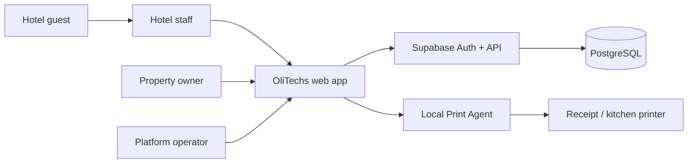
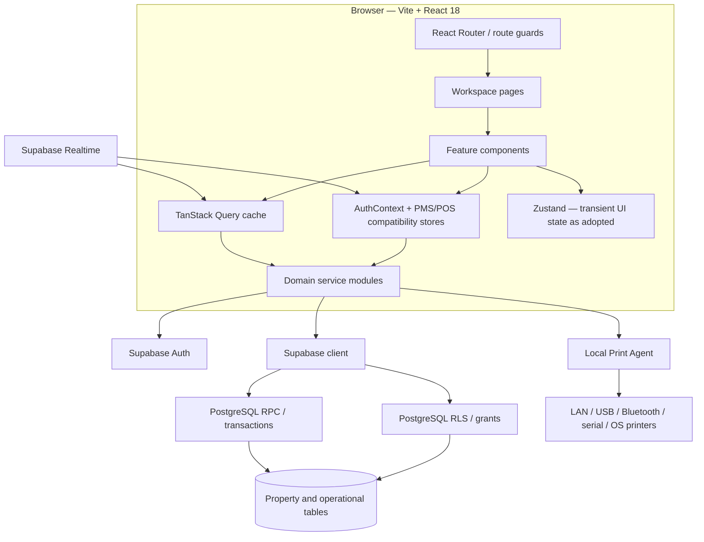
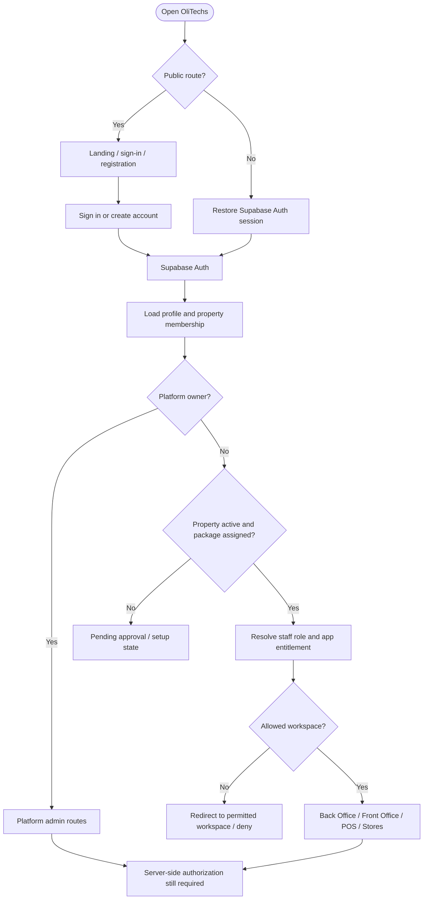
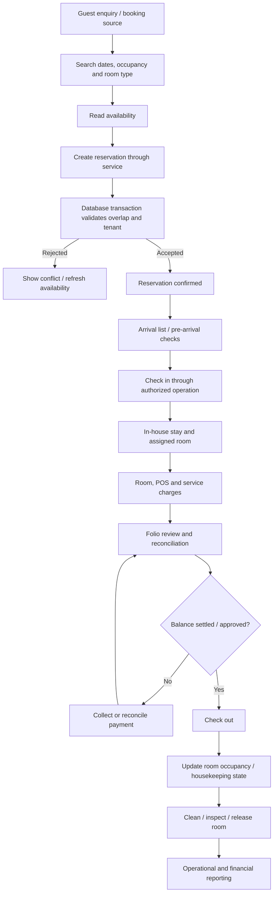
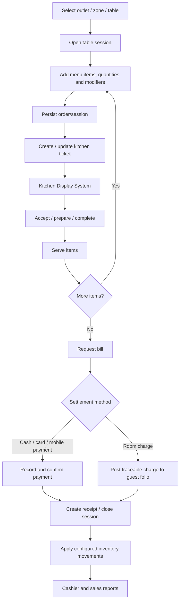
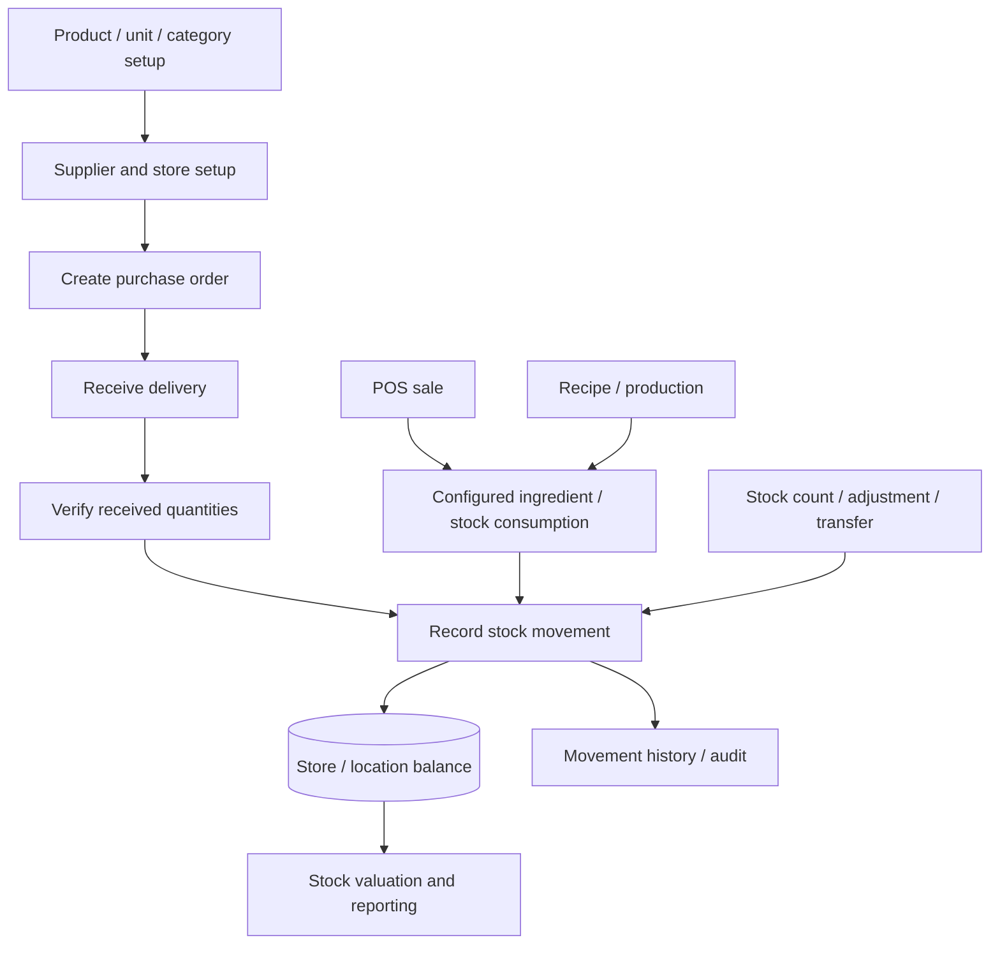
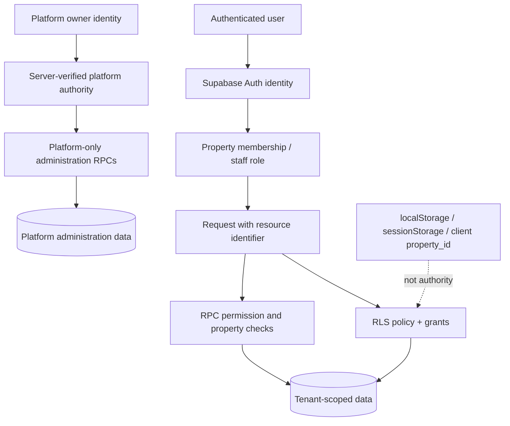
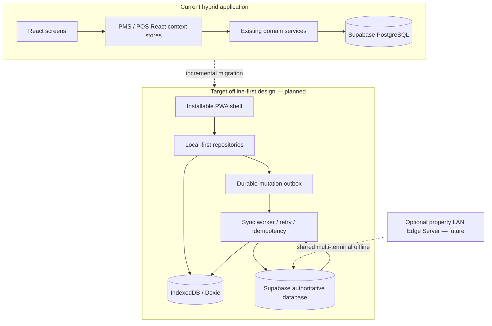

# OliTechs — Visual Architecture

These Mermaid diagrams are source-controlled architecture visuals. GitHub renders them in this Markdown file. They describe the current architecture and the intended evolution separately; planned components are marked as targets and must not be mistaken for deployed functionality.

## 1. System context

## 2. Runtime and application layers

**Current-state note:** QueryClient and service modules exist, but the app remains hybrid. TanStack Query is not yet the exclusive server-state path; the context stores remain important compatibility layers.

## 3. Authentication and workspace entry

Client route guards improve navigation and user experience. They do not replace RLS or server-side authorization.

## 4. Reservation to departure lifecycle

The database is the final protection against concurrent room assignment. The UI's availability display is advisory.

## 5. Restaurant POS to kitchen to folio

Payment-provider acknowledgement, inventory deductions and room-charge posting must be verified in their actual implementation before changing the flow. Printing is a side effect; a printer outage must not create a duplicate sale.

## 6. Inventory lifecycle

Stock changes should be represented as auditable movements and validated by trusted backend authorization. Do not replace a ledger with client-side quantity edits.

## 7. Property tenant security boundary

Never trust a client-supplied property ID, role string, hidden button or browser storage flag as authorization evidence.

## 8. Current hybrid state to target offline-first architecture

**Important:** browser IndexedDB belongs to one browser profile/device. It does not synchronize reception, restaurant and kitchen computers with one another while the internet is down. Shared property-wide offline operation requires a separately designed LAN Edge Server and reconciliation protocol.

## 9. Delivery pipeline

```mermaid
flowchart LR
  Task[Approved task] --> Inspect[Read docs / inspect source / baseline]
  Inspect --> Plan[Scope / risks / acceptance tests]
  Plan --> Code[Small implementation]
  Code --> Lint[Lint + typecheck]
  Lint --> Tests[Unit / contract / security tests]
  Tests --> Build[Production build]
  Build --> Review[Diff and regression review]
  Review --> Commit[Focused commit / PR]
  Commit --> Deploy[Approved deployment]
  Deploy --> Smoke[Production smoke tests]
  Smoke --> Monitor[Observe / document / next task]
```

## 10. Diagram maintenance

When code changes alter a workflow:
1. Update the relevant diagram and the workflow catalogue in the same change.
2. Label planned capabilities as planned.
3. Do not depict an external provider integration as live without verified credentials, callbacks and tests.
4. Keep diagrams consistent with `Architecture.md`, `Rules.md` and `Phases.md`.
