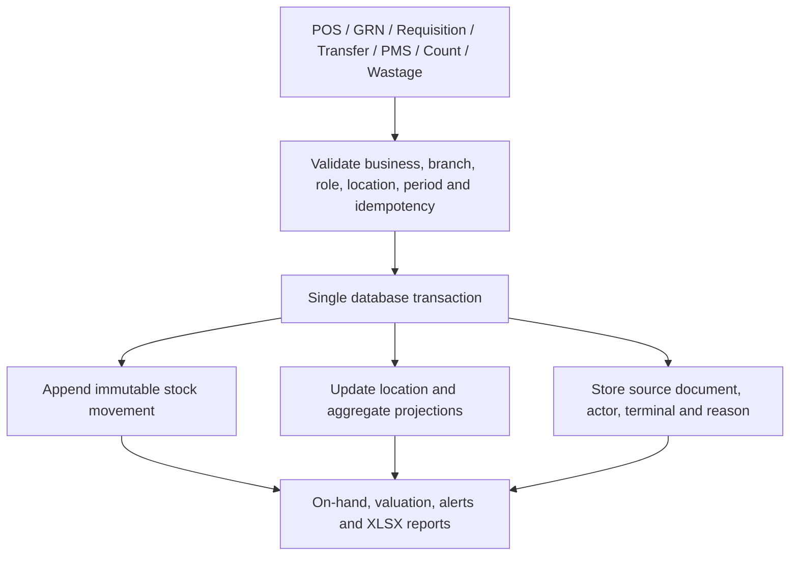

# OliTechs Storekeeper — Architecture and Phase 0 Audit

**Repository:** `olitechs/olitechpmspos`  
**Implementation branch:** `feat/storekeeper` (branched from `main`)  
**Phase:** 0 — audit only  
**Database:** existing Supabase production project, inspected read-only  
**Status:** No application code or production data changed during this audit.

## 1. Executive summary

OliTechs already has a property-scoped inventory subsystem. The authoritative stock model is currently `products` + `stock_movements`, with `product_stock_locations` as a location-balance projection. Purchasing, GRNs, suppliers, transfers, stock counts, adjustments, wastage, production and recipes also exist.

The current Store experience is split across two different areas:

- `/stores` is a workspace for configuring physical store/outlet names and related POS devices, printers and KDS screens.
- The inventory and purchasing workflows are primarily under Back Office, including the legacy `Store / Controls` product screen, purchasing, inventory operations and inventory reports.

The new Storekeeper must consolidate these capabilities without creating a second stock ledger or second copy of the product catalogue. Preserve the current property-based access model as the compatibility boundary while introducing explicit business and branch mapping. Do not equate a branch with a stock room/bin: a branch owns multiple inventory locations.

## 2. Current application map

### Routes and screens

| Current route | Current component / responsibility | Storekeeper impact |
|---|---|---|
| `/stores` | `StoresLayout` + `StoresPage`; CRUD for `stores` records | Current workspace landing page is not an inventory dashboard. Replace its presentation with Storekeeper while preserving its existing records and device references. |
| `/stores/settings` | Redirects to `/stores` | Keep as a compatibility redirect; do not remove. |
| `/stores/pos-devices` | POS device management | Preserve and relocate under Storekeeper navigation without breaking the old URL. |
| `/stores/printers` | Kitchen printer configuration | Preserve route and print configuration. |
| `/stores/kds` | Kitchen Display | Preserve route and KDS behavior. |
| `/backoffice/items/list` | `Store` page, opened on Products tab | Existing product catalogue and import/export surface; migrate into Storekeeper item master. |
| `/backoffice/inventory/purchase-orders` | `Purchasing` | Existing purchase-order workflow; extend into receiving/GRN rather than replace. |
| `/backoffice/inventory/transfer-orders` | POSApp Transfers module | Existing transfer UI; reconcile with inventory transfer RPCs. |
| `/backoffice/inventory/stock-adjustments` | `InventoryOperations` adjustments tab | Preserve as a workflow and move under Storekeeper. |
| `/backoffice/inventory/counts` | `InventoryOperations` counts tab | Preserve count creation and approval behavior; fix ledger/location correctness first. |
| `/backoffice/inventory/productions` | `InventoryOperations` production tab | Preserve recipe production posting. |
| `/backoffice/inventory/history` | `InventoryOperations` history tab | Rebuild as a complete, paginated ledger view. |
| `/backoffice/inventory/valuation` and `/backoffice/reports/inventory` | Inventory valuation/reconciliation | Preserve figures but reconcile them to the ledger before adding new reports. |
| `/backoffice/items/categories` | POS/product category setup | Existing POS categories are not a complete inventory department/category master. |

The current React Router registration includes the inspected legacy routes. The old route-inventory notes in the repository are not fully current: some observations (for example, the old Access Rights link mismatch and the old POS Devices placeholder) do not match the present `main` source. A fresh code-level check did not identify a confirmed broken Storekeeper route to patch in Phase 0. The old `/store` alias currently redirects to `/stores`; it must later redirect to the new canonical Storekeeper route, with all old nested routes retained as redirects or aliases.

### Existing code entry points

- `src/pages/Store.jsx` — legacy Store / Controls catalogue, suppliers, purchases, usage, alerts and import/export.
- `src/components/stores/StoresPage.jsx` — store/outlet configuration.
- `src/components/layout/StoresLayout.jsx` and `src/components/layout/AppShell.jsx` — workspace shell/navigation.
- `src/data/modules/navArchitecture.js` — top-level workspace, entitlement mapping and Store navigation.
- `src/data/modules/sidebarNavigation.js` — Back Office navigation and role visibility.
- `src/services/inventoryService.js` — catalogue, imports, suppliers, purchases, GRNs, movements, counts, adjustments, wastage, production and exports.
- `src/services/pmsService.js` — POS sale, folio, cashier, transfers, recipes, housekeeping, laundry and maintenance RPC calls.
- `src/components/pos/POSContainer.jsx`, `OrderTaking.jsx`, `BillPayment.jsx` — POS order, KOT, cancellation and payment flow.
- `src/components/modules/InventoryOperations.jsx`, `InventoryReports.jsx`, `Purchasing.jsx`, `Recipes.jsx` — current operational screens.

## 3. Live database inventory

The production schema is property-centric. Existing stock-related tables are protected by RLS, but row-level membership is not equivalent to a Storekeeper role/action permission.

Observed row counts at audit time (read-only metadata):

| Table | Rows | Current purpose |
|---|---:|---|
| `products` | 850 | Existing item master, POS catalogue linkage and current aggregate stock |
| `stock_movements` | 4 | Current shared stock ledger |
| `product_stock_locations` | 2 | Location balance projection |
| `pos_menu_categories` | 55 | POS menu categories with production centre |
| `inventory_items` | 0 | Older inventory item model |
| `inventory_movements` | 0 | Older movement model |
| `inventory_locations` | 0 | Named stock locations |
| `stores` | 0 | Store/outlet configuration records |
| `stock_usage` | 0 | Manual department usage records |
| `purchase_orders` | 0 | Purchase orders |
| `recipes` | 0 | Recipe definitions |
| `stock_transfers` | 0 | Transfers |
| `inventory_counts` | 0 | Stock counts |

Counts are a point-in-time snapshot, not a migration instruction. The 850 existing products must remain intact.

### Existing stock model

- `products` stores SKU, name, category, unit, current/min/max stock, cost/selling price, supplier, a text location, expiry date, POS flags and production-centre metadata.
- `stock_movements` stores `property_id`, `product_id`, `type`, `qty`, `reason`, `user_id`, `created_at`, `source_type` and `source_id`.
- `inventory_locations` stores property-scoped location names.
- `product_stock_locations` stores property/product/location quantities.
- `pos_menu_categories.production_center` distinguishes production routing (e.g. Kitchen/Bar), but it is not a normalized department assignment on every item and movement.
- `stock_usage.department` is free text and only exists on the usage record.
- `goods_receipts` and `goods_receipt_lines` provide GRN headers and line quantities/costs.
- `purchase_orders` holds PO line payloads in JSON and supplier/order state.
- `stock_transfers`, `inventory_counts`, `inventory_count_lines`, `stock_adjustments`, `inventory_wastage`, `inventory_productions`, `recipes` and `recipe_ingredients` are already present.

The older `inventory_items` / `inventory_movements` tables are empty in the observed database. Do not begin writing new transactions to them. Keep them readable for compatibility and use a controlled, auditable migration only if historical rows are discovered in another tenant/environment.

### Important schema gaps and integrity risks

1. The current `stock_movements` row does not store source/destination location, department, unit, movement-time unit cost, device/terminal, reason code, branch, or a stable event/line idempotency key. Its `type` is a generic direction such as `in` / `out`, not the complete business movement taxonomy.
2. Current POS sale and recipe movements call `fn_apply_stock_movement` with a NULL `source_id`. The reversal helper also writes NULL source ids. Transfer completion inserts paired movement rows directly and does not populate source type/id. This weakens traceability from a movement to a POS receipt, refund, recipe batch or transfer.
3. `products.current_stock` is the aggregate/compatibility balance. `product_stock_locations` is a second projection. The `products_sync_default_location` trigger runs after product stock updates. Existing adjustment, count and wastage RPCs can also write a location balance before invoking the shared movement writer; this creates a documented double-application / wrong-location risk.
4. Live policies allow UPDATE on `stock_movements`, DELETE on `stock_usage`, and direct INSERT/UPDATE/DELETE on `product_stock_locations` for property members. This does not meet an immutable posted-ledger contract.
5. Several SECURITY DEFINER stock mutation RPCs authorize property membership but do not enforce the intended Storekeeper action/role entitlement. Membership alone must not authorize receiving, issuing, approving counts, adjusting, transferring or viewing cost.
6. Product cost is masked in the React service for some roles, but the `products_select` policy exposes product rows to property members and the inventory valuation RPC returns cost fields. UI masking is not a security boundary.
7. Current movement, usage and inventory history lists are capped at 500 rows. The existing XLSX export is a single movement worksheet, not a paginated multi-department workbook with reconciled opening/closing values.
8. Expiry is represented as a product-level date and wastage date, not a batch/lot ledger with per-batch quantity, received date, supplier and expiry.
9. Existing tenancy uses `property_id`. There is no established `businesses` / `branches` model in the audited stock schema. `stores` and `inventory_locations` are not interchangeable: the former is a store/outlet configuration entity, the latter is a stock holding location.

## 4. POS and hotel stock-event map

### POS order and payment

1. `OrderTaking` reads the POS menu using `fn_list_pos_menu`.
2. Sending a KOT from `POSContainer.handleSendToKitchen` persists the kitchen order snapshot and prints production tickets. It does **not** currently post a stock movement.
3. Removing an item after it has been sent uses `fn_remove_pos_item`, records a POS void item and prints a void slip. It does not reverse stock because the current stock deduction has not yet happened.
4. Payment in `BillPayment.confirmPayment` calls `pmsService.recordPosSale`, which calls `fn_record_pos_sale_with_vat_snapshot` and then `fn_record_pos_sale`.
5. The sale RPC creates the receipt/payment/folio effects and stock deductions in the same database transaction. It calls `fn_consume_recipe_stock` for active recipes, then deducts direct tracked product lines through `fn_apply_stock_movement`. The direct item loop skips menu items with active recipes, preventing a second ingredient deduction. The receipt idempotency key prevents a normal duplicate receipt submission.
6. POS room-charge and split-payment sales use the same sale RPC; a room-charge portion creates a folio charge as part of the sale transaction. The separate `charge_restaurant_to_room` helper is a financial folio charge path and does not itself post stock.

**Current deduction trigger:** payment/receipt posting, not KOT send. This is consistent with the current atomic sale/payment RPC, but stock is not consumed at the moment food/drinks are fired to production. This is a policy decision to resolve in Phase 3. The requested “deduction and payment succeed or fail together” rule conflicts with posting at KOT send, which occurs before payment. Recommended safe migration path: preserve payment-time posting initially, add a per-business policy and idempotent order-line event contract, then enable send-time posting only when the KOT lifecycle, cancellations, offline replay and refund rules are covered by tests. Never allow both send-time and payment-time paths to deduct the same line.

### POS voids and refunds

- Pre-payment KOT item removal is handled by `fn_remove_pos_item`; it changes the open order and records a void event but does not restock.
- Approved cashier void/refund workflows call `fn_reverse_pos_stock` to restore direct product or recipe ingredient quantities. The current refund helper derives a ratio from refund amount versus receipt total; money-only refunds and physical goods returns need distinct policy.
- Current reversal movements do not carry a stable source id linking them to the cashier adjustment/refund and original movement. Duplicate/replay and cumulative partial-refund protection need explicit tests.
- Split payments are recorded within the single POS sale RPC; stock is currently deducted once at the receipt level.

### PMS / hotel functions

| Workflow | Current stock behavior |
|---|---|
| POS restaurant charge to room | Stock is deducted through the POS sale RPC when the room payment allocation is part of that sale. |
| Standalone folio/restaurant charge | Financial folio charge only; no stock posting. |
| Minibar / room amenities | Helper methods exist in `inventoryService`, but no current callsite was found in the active application source. No automatic minibar issue is established. |
| Housekeeping consumables | Housekeeping task create/update/inspect flows do not post stock. A legacy helper exists but no active callsite was found. |
| Linen issue / return | No integrated stock movement path found. |
| Laundry | Laundry orders and status updates exist; no active stock consumption path found. |
| Maintenance spares | Maintenance tickets exist; no parts issue/return path found. |
| Staff meals / complimentary / house use | No automatic stock movement path found. |
| Generic stock usage | Store UI calls `fn_record_stock_usage`, which posts a negative movement and writes a `stock_usage` record. |
| GRN / receiving | `fn_receive_purchase_order` creates a GRN and posts received quantities through the shared stock movement helper. A legacy one-step `fn_create_and_receive_purchase` path also exists. |
| Transfers | `fn_create_stock_transfer` creates a pending transfer; `fn_complete_stock_transfer` writes location balances and paired ledger rows directly. |
| Adjustments / counts / wastage / production | `fn_post_stock_adjustment`, `fn_approve_inventory_count`, `fn_post_wastage`, `fn_post_production` exist; location projection and source-link risks above must be resolved before extending them. |
| Product import | `fn_bulk_upsert_store_products` is the import/upsert path and can reconcile stock deltas through the shared movement path. Define import quantity semantics and idempotency before adding more import features. |

## 5. Phase 0 target architecture draft

This is a migration direction, not an instruction to apply schema changes during Phase 0.

### Tenant and location model

- Introduce a generic `businesses` parent and `branches` child only with an explicit mapping to existing `properties`. A practical compatibility mapping is one existing property to one branch, with a business allowed to own multiple branches. Keep `property_id` and existing RLS checks during migration; do not weaken or bypass them.
- A branch is the hotel/restaurant/outlet operating boundary. An inventory location is a stock-holding place inside a branch (Main Store, Bar Store, Kitchen Store, cold room, housekeeping store, etc.). Never use a store room as a business branch.
- Every new table and every new query must carry and validate `business_id` and `branch_id`, as well as the compatibility property scope where existing services require it.
- Keep `products` as the existing catalogue source of truth during migration. Add normalized department, category, unit conversion, barcode and batch metadata additively. Do not create a parallel catalogue and do not copy 850 products into a second live master without a compatibility plan.

### Proposed logical model

| Entity | Purpose | Existing relationship / migration direction |
|---|---|---|
| `businesses` | Tenant/company parent | Map existing property ownership into a business; no cross-tenant joins by display name. |
| `branches` | Operating branch/outlet | Map each current `properties` row to a branch; preserve property_id during rollout. |
| `departments` | BAR, KITCHEN, HOUSEKEEPING, GENERAL/MAINTENANCE | Normalized, business/branch-scoped; BAR and KITCHEN are defaults. |
| `categories` | Item classification | Normalize category + department; retain POS category ids/names as compatibility links. |
| `products` (existing item master) | SKU/barcode, unit, pack size, cost, par/reorder, active, expiry tracking | Extend additively; maintain current product IDs used by POS, recipes and receipts. |
| `unit_conversions` | Pack/base-unit conversions | Versioned conversion ratios; ledger quantities use a defined base unit. |
| `inventory_locations` | Physical stock holding locations | Extend with branch and location type; keep location id distinct from branch id. |
| `stock_batches` | Lot, expiry, received qty, supplier and GRN trace | New additive batch table linked to product and GRN line. |
| `stock_movements` (existing ledger) | Immutable movement events | Extend existing ledger; no parallel ledger. Add movement type, location from/to, department, unit, unit cost snapshot, reference, actor/device and idempotency/source-line keys. |
| `purchase_orders`, `goods_receipts`, `goods_receipt_lines` | Purchasing and GRN | Reuse and extend existing PO/GRN tables. |
| `requisitions`, `requisition_lines` | Department request, approval and issue | New additive workflow tables with request/issue/receipt states and confirmation identity. |
| `stock_transfers` | Transfer request and in-transit lifecycle | Reuse and extend existing transfer header; add durable lines and sender/receiver confirmation. |
| `inventory_counts`, `inventory_count_lines` | Cycle/month-end count and variance review | Reuse and extend; approval posts compensating ledger entries. |
| `storekeeper_settings`, `period_locks`, `movement_approvals` | Per-business policy, close lock and separation-of-duties | New scoped configuration/control records. |

### Ledger event flow

The ledger is authoritative. Balances are projections and must reconcile to ledger totals. Corrections are new compensating/reversal movements; posted rows are never edited or deleted. Every event must have one posting owner and a stable source idempotency key.

### Movement taxonomy

Use explicit business movement types (direction and event meaning are separate fields):

- `opening_stock`
- `purchase_grn`
- `issue_to_department`
- `transfer_out`
- `transfer_in`
- `pos_sale`
- `void_cancel_reversal`
- `refund_return`
- `wastage`
- `breakage`
- `spoilage`
- `comp_house_use`
- `staff_meal`
- `room_consumption`
- `adjustment`
- `stock_count_correction`
- `return_to_supplier`

A transfer produces a linked OUT and IN movement and preserves branch-level total stock. A return/refund restores stock only when the goods are physically returned to stock. Financial refunds without a physical return must not create an inventory receipt.

## 6. Phase 0 findings and implementation gates

### Must be resolved before Phase 1 schema work

1. Define the business-to-property-to-branch mapping and decide whether one property is one branch or whether the current `stores` entity is intended to represent an outlet. Do not equate `stores` and `inventory_locations`.
2. Define the stock invariant: `products.current_stock` should be the sum of all active location balances, with legacy no-location quantities explicitly mapped. Remove double-write behavior only after tests prove the replacement.
3. Reconcile the existing `stock_movements` ledger and location projection; enforce append-only posting and revoke direct client writes to projections.
4. Add server-side action authorization for every stock mutation and cost/valuation read. UI role hiding is insufficient.
5. Give every posting a stable source type, source id and source line/idempotency key. POS receipt/order line, GRN line, transfer line, count line and adjustment id must be traceable.
6. Define movement-time costing (received unit cost / chosen costing policy) before COGS and historical valuation reports.
7. Confirm the current production schema against committed migration provenance; do not replay historical migrations or assume the local migration folder is an exact live schema snapshot.

### Recommended implementation order

- Phase 1: reconcile and harden the existing ledger, add business/branch compatibility mapping, departments, categories, item metadata, units/conversions, locations and batches. No second product catalogue or second ledger.
- Phase 2: add receiving details, requisitions, two-party transfers, reason-coded waste/comp, count approvals and period locks.
- Phase 3: wire POS and PMS source events through one idempotent posting service. Start from the existing payment-time atomic sale path; decide send-to-production policy before enabling it.
- Phase 4: add paginated ledger-based reports and XLSX/PDF exports. Every report total must reconcile to the same ledger query.
- Phase 5: enforce the role matrix, approvals, immutable audit trail and exception alerts.
- Phase 6: run integration/regression tests for every event, role and reversal path, including POS print and Shift Report smoke tests.

## 7. Risks and open decisions

- **POS trigger timing:** KOT send is earlier than payment. Choose whether stock is consumed on KOT send or payment; never run both. The existing atomic sale RPC currently makes payment-time posting the least disruptive default, but it leaves an operational gap for prepared, unpaid orders.
- **Refund policy:** determine whether each refund represents physical goods returned, money-only compensation, or partial goods return. Amount-based proportional stock reversal is not sufficient for all cases.
- **Costing:** choose moving average, FIFO or another auditable method before COGS reports.
- **Branches:** confirm whether a single business may own multiple hotel properties/branches and how existing store/outlet records map.
- **Offline POS:** define how send-time stock events are replayed idempotently after offline use and how conflicts are surfaced.
- **Print safety:** Storekeeper screens must not change print payloads, print-agent transport, receipt/KOT templates or shift close code paths.
- **Reports:** current 500-row caps and incomplete movement metadata cannot support complete period exports until server-side pagination/aggregation and source linkage are in place.

## 8. Verification record

- Repository stack/scripts inspected from `package.json`: React 18, Vite 6, Supabase JS, PostgreSQL RPC/RLS, XLSX dependency already installed.
- Scripts available: `lint`, `build`, `typecheck`, `test:architecture`, `check:contrast`, `check:coastal-linen`.
- POS sale, KOT, item removal, room-charge, GRN, stock usage, transfer, adjustment, count, wastage, production, and refund/void call paths inspected in source and/or live PostgreSQL function definitions.
- Live table/column, row-count, trigger, RLS policy and function metadata inspected read-only.
- No schema or production data changed.
- A local clone could not be created in this execution environment because outbound DNS/network access to GitHub was unavailable. Therefore lint/build/typecheck were not run here. No claim of passing local tests is made. Run the repository scripts in CI or a connected checkout before Phase 1 code changes.

## 8. Storekeeper dashboard — approved home-screen requirements

The canonical inventory workspace landing route will be `/storekeeper`. The existing `/stores` configuration records and their POS device, printer and KDS relationships must remain intact. Preserve legacy URLs as aliases/redirects; do not delete or repurpose the `stores` table. Storekeeper becomes the inventory operations workspace, not a destructive rename of the store/outlet entity.

### Global dashboard controls

- Business and branch switcher, with only memberships the signed-in user is authorized to access.
- Current date and period selector: Today, This Week, This Month, Custom.
- Department filter: All, Bar, Kitchen, Housekeeping, General.
- Global item search supporting SKU/name/barcode and barcode-scanner input.
- Filters must be applied consistently to every dashboard query, KPI, chart, alert and movement feed. Every request must be scoped by the authorized business and branch (and the legacy property scope during compatibility rollout).

### Row 1 — KPI cards (all clickable)

1. Current stock value with comparisons to last week and last month.
2. Today's POS sales with Bar/Kitchen split.
3. Today's issued, consumed and wasted stock value.
4. COGS percentage for today, this week and this month.
5. Below-reorder, out-of-stock and expiring-within-seven-days item counts.
6. Open purchase orders and deliveries expected today.
7. Pending requisitions and transfers in transit.
8. Last stock-count variance in value and percentage.

Each KPI must navigate to a filtered detail/report view. Show loading skeletons, a meaningful no-data state and a recoverable error state; do not display fabricated zeroes when data is unavailable.

### Row 2 — prioritised Stock Alerts

Alert groups: out of stock, critical low, below reorder, below par, expired/expiring batches, overstock, slow-moving items, fast movers with estimated days of cover, and unusual activity (large adjustments, wastage spikes, issues without requisitions, after-hours movements, negative stock and supplier price jumps).

Each alert supports the appropriate permitted action: create requisition, raise purchase order, transfer stock, start count, or dismiss with a required note. Actions must respect role permissions, branch scope, approval rules and audit logging. Dismissal must not delete source movements or hide a still-active critical condition globally.

### Row 3 — operations

- Today's deliveries with expected/received quantities and partial/late status.
- Requisitions awaiting approval or issue.
- Transfers awaiting dispatch/receipt confirmation.
- Recent movement feed with actor, item, location, quantity and source document.

### Row 4 — trends and analysis

- Daily POS sales versus stock consumption for 7- and 30-day periods.
- Weekly/monthly stock-value trend with Bar/Kitchen breakdown.
- Top 10 selling items, top 10 wasted items and top 10 highest-value stock items.
- Department-level usage versus sales variance.

### Dashboard implementation and data integrity requirements

- Build the dashboard against the authoritative existing `products` and `stock_movements` model and reused PO/GRN, requisition, transfer, count, waste and POS records. Do not introduce a second product catalogue or ledger to make dashboard queries easier.
- Dashboard summaries must be computed from scoped, paginated/aggregated server-side queries or narrowly defined database functions; never download an unbounded ledger to the browser.
- Value metrics must use a documented costing method and movement-time cost snapshots. Until costing and required source links are reliable, show an explicit unavailable/not-yet-reconciled state instead of a misleading figure.
- Batch expiry and days-of-cover alerts require batch/lot and usage history support; do not infer batch quantities from a single product-level expiry date.
- Sales, COGS and usage-versus-sales comparisons must use consistent business-day boundaries and department mapping.
- Barcode scanning must degrade gracefully to keyboard-wedge scanner input and manual search when camera permission or hardware is unavailable.
- Every clickable KPI, alert, chart segment and operations row must have a stable destination/action and preserve current business, branch, period and department filters.
- The dashboard must remain usable on tablet and desktop, follow the existing OliTechs Coastal Linen design tokens, and provide accessible labels, keyboard navigation and clear focus states.
- Do not change POS receipt/KOT payloads, print-agent transport, receipt/ticket templates or Shift Report as part of dashboard work.

### Delivery dependency

The dashboard UI is not considered complete merely because cards render. Phase 1 must establish the scoped foundation and normalized department/location/item metadata; Phase 2 supplies requisition/receiving/transfer/count workflows; Phase 3 supplies traceable POS/PMS consumption; Phase 4 supplies reconciled reporting; Phase 5 supplies role-aware action permissions and audit history. Dashboard panels should be enabled as their source data and authorization are verified, with unavailable states for later-phase metrics until then.
